<p align="center"></p>
<h1 align="center">PEA</h1>
<p align="center"><strong>Pump Engineer Everything</strong></p>
<p align="center">Every launch leaves a trace.</p>

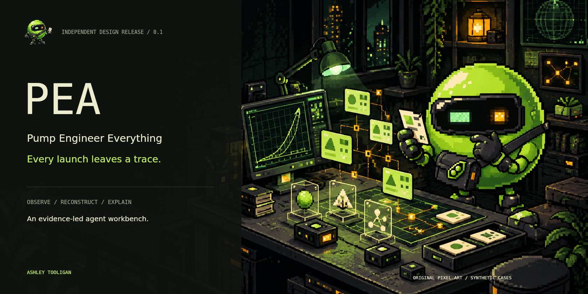

**PEA is an AI agent design for reverse-engineering Pump.fun launch behavior from public evidence.** A launch becomes a case: reconstruct the sequence, inspect the transactions, follow wallet routes, study the mechanism, challenge the explanation, and produce a receipt.

The goal is an investigator you can question. A price move opens the conversation; the agent's useful work is explaining the events behind it and keeping its uncertainty visible.

**Design release 0.1** includes an original pixel agent, a fourteen-view interactive workbench, three synthetic example cases, annotated screenshots, proposed tool contracts, and a detailed production architecture. The local preview displays authored fixtures. Solana ingestion, model execution, production decoding, wallet signing, and trade execution are planned interfaces, not connected services in this release.

[Meet PEA](#meet-the-agent) · [Open the preview](#open-the-workbench) · [Visual tour](#the-workbench) · [Agent architecture](docs/ARCHITECTURE.md) · [Tool contracts](specs/TOOL-CONTRACTS.md) · [Full gallery](docs/GALLERY.md) · [Upload guide](GITHUB-UPLOAD.md)

## The idea in one minute

Ask PEA: **“What happened before this launch's first burst of buys?”**

The proposed agent opens a bounded evidence window. It follows transactions back to actors and program events, records the schema used to interpret them, and builds a case graph. It separates observed transfers from interpretations about coordination or ownership. A second pass looks for other explanations. The final brief carries its source references and unresolved questions.

| Stage | What PEA would do | Result |
|---|---|---|
| Observe | Read a declared public-data window | Source records and coverage notes |
| Reconstruct | Order and normalize the relevant events | A launch timeline |
| Relate | Map transfers and program interactions | A labeled relationship graph |
| Explain | Build claims tied to evidence | A readable case brief |
| Challenge | Search for counterexamples and missing context | Revised claims and open questions |
| Rehearse | Evaluate a hypothetical plan against a policy | A reviewable sandbox result |
| Package | Preserve the case and its provenance | A portable receipt |

The visual vocabulary is deliberately simple: **a small green engineer opening a large machine.** The machine is a launch's public trace.

## Meet the agent

<p align="center"></p>

PEA has a broad black visor, one mint eye, one amber scanner, a diagonal tool satchel, and an inconvenient habit of asking for the missing receipt. Its personality is curious and precise. Its explanations should be short enough to read and structured enough to inspect.

The character is original artwork made for this project. It is not a Pump.fun mascot, a fork of another agent's branding, or a token endorsement. [Visual provenance and prompts](assets/PROVENANCE.md) record all three illustrations and how the UI captures were made.

## Open the workbench

Download the repository, extract it, and open **[PEA.html](PEA.html)**. It embeds the interface, fixtures, and artwork and opens locally without an account or API key. Windows users can use [Start-PEA.bat](Start-PEA.bat).

The view selector and top navigation open fourteen screens. The case selector switches between three synthetic investigations. The event slider replays the bundled records. The toolbar can export the current Canvas as PNG or a demo case receipt as JSON.

For the modular source, use Node.js 20 or newer:

```sh
npm start
```

Open `http://127.0.0.1:4180`. Rebuild the embedded file with `npm run build`. Check fixtures, image paths, and source syntax with `npm run check`.

To recapture screenshots, install the optional native Canvas package:

```sh
npm install --no-save @napi-rs/canvas@0.1.100
npm run screenshots
```

The preview requires no runtime packages. Its controls explore a product design; they do not initiate live investigations or move funds. [Start guide](docs/START.md) · [Preview scope](docs/RELEASE.md)

## The workbench

### 01 / The agent desk

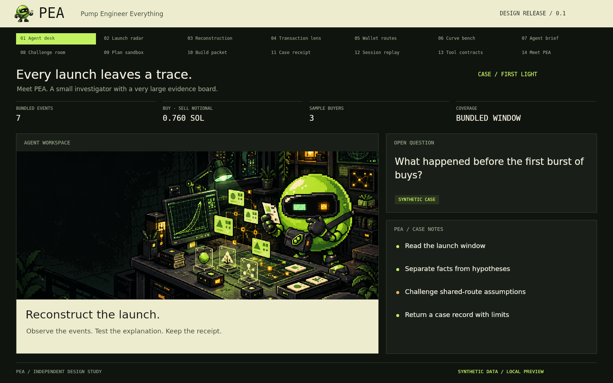

A question, a case, and an evidence board. The desk introduces the agent and keeps the current investigation visible. The header shows the bundled event count, sample buyers, buy-minus-sell notional in SOL, and declared coverage. These values come from the selected fixture.

### 02 / Launch radar

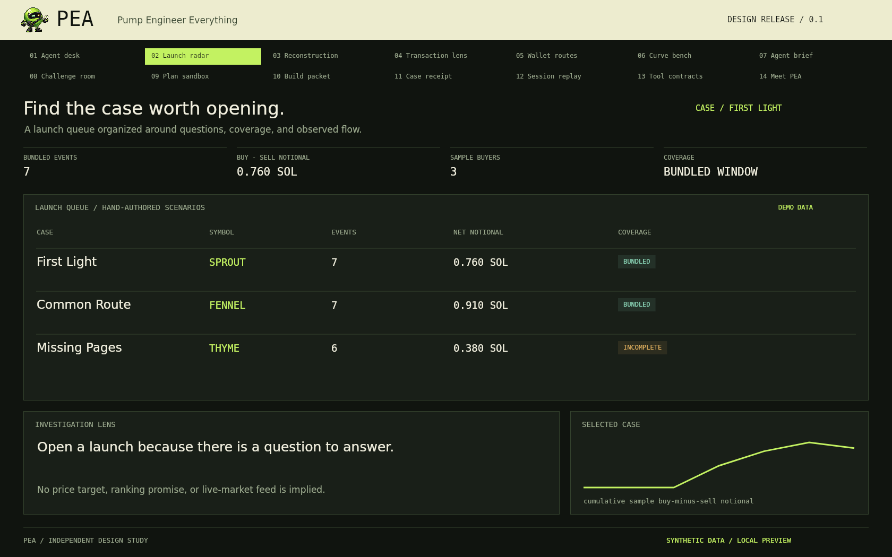

A queue of cases organized around what needs explaining. The example names SPROUT, FENNEL, and THYME are fictional fixture labels. The queue presents coverage and observed sample flow, not a list of recommended purchases.

### 03 / Reconstruction

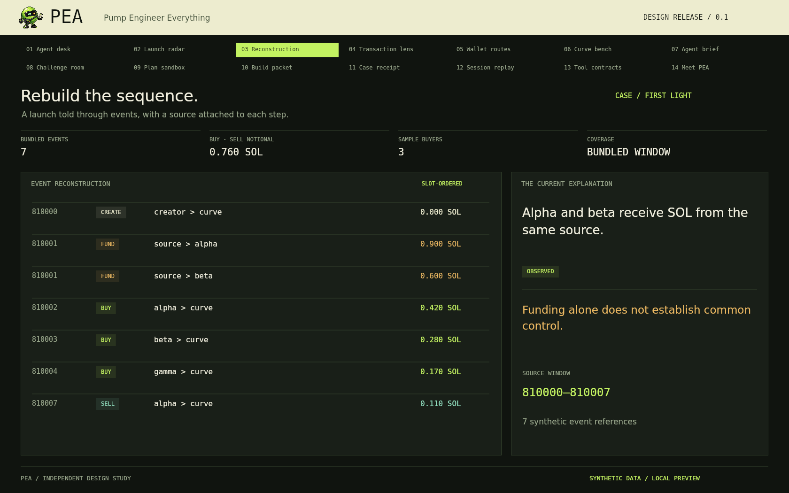

The first case contains creation, funding, buys, and a sell. Every step carries a synthetic transaction reference and slot. A production reconstruction would also preserve transaction and instruction order within a slot. [Reconstruction specification](docs/RECONSTRUCTION.md)

### 04 / Transaction lens

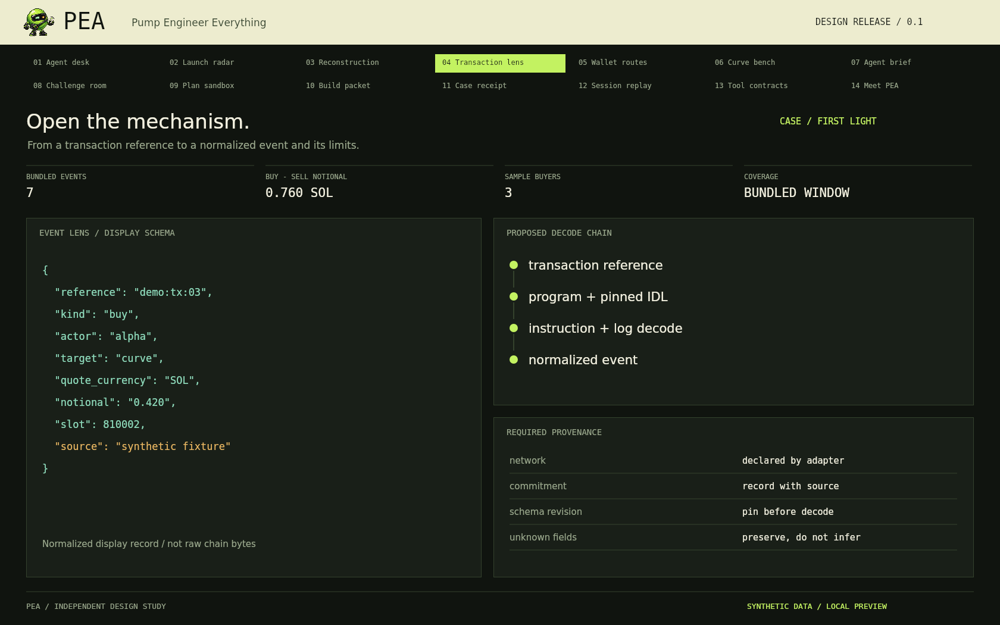

The lens shows how an event should become explainable: its source, interpretation, amount, and limits remain attached. The displayed JSON is a normalized design record, not a raw transaction or a claim that a real Pump.fun instruction has been decoded. Production decoding needs a pinned program schema. [Adapter design](docs/PUMP-ADAPTER.md)

### 05 / Wallet routes

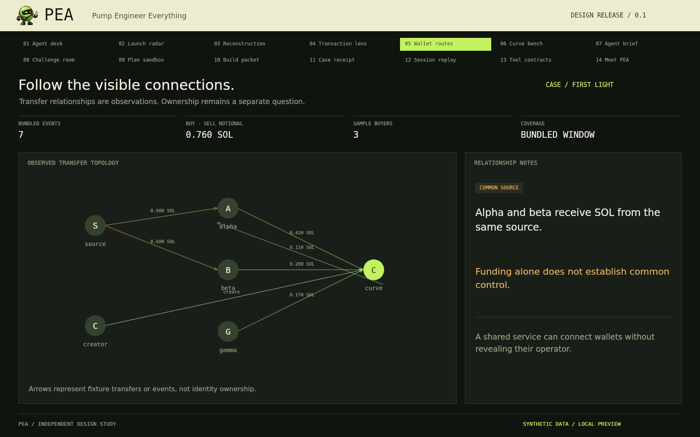

Connections are useful evidence. They are not identities. A shared funding source can have several explanations, including a common service. PEA's proposed graph keeps the observed edge and the ownership hypothesis separate. [Relationship rules](docs/WALLET-ROUTES.md)

### 06 / Curve bench

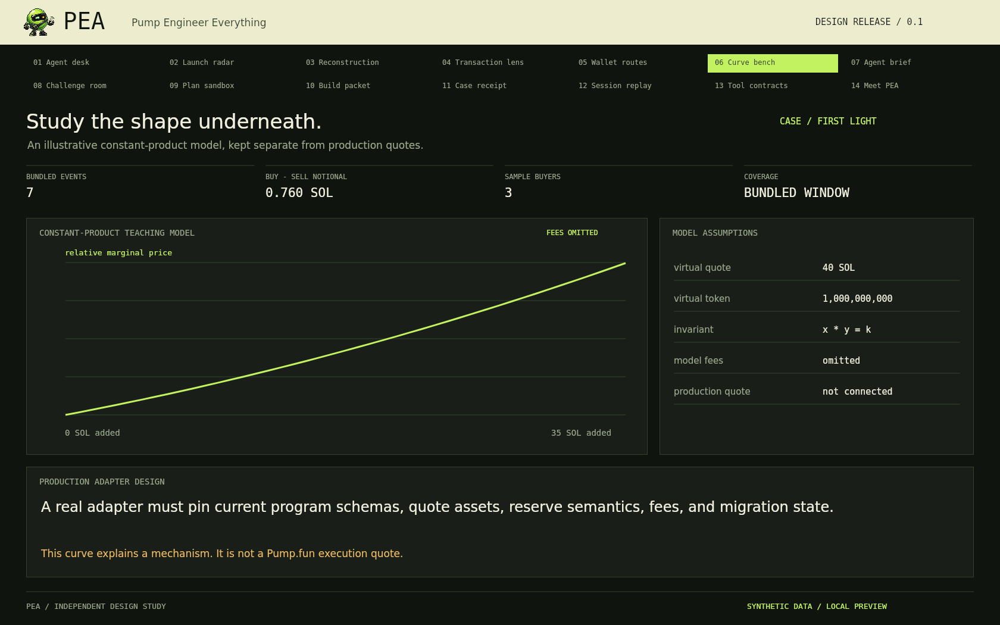

The curve bench explains a generic mechanism using a declared teaching model: 40 virtual SOL, one billion virtual tokens, and a constant-product invariant. Fees are omitted. This is not a Pump.fun execution quote, a migration model, or a calibrated price forecast. A production adapter must account for current quote assets, reserve semantics, program revisions, and fees. [Curve model](docs/CURVE-MODEL.md)

### 07 / The agent brief

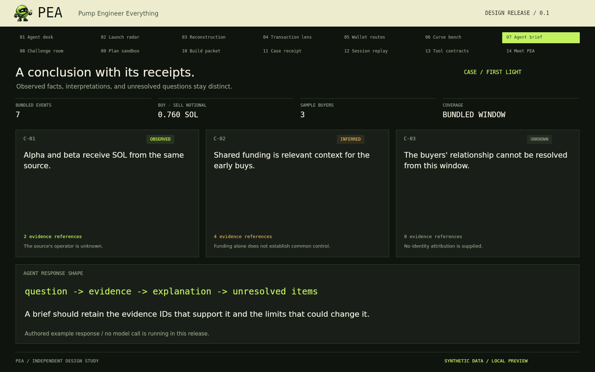

Three statuses do more work than one vague confidence score: **observed**, **inferred**, and **unknown**. Every proposed response should say what supports it and what could change it. The example brief is authored; no language-model session is running in the preview. [Agent behavior](docs/AGENT.md)

### 08 / The challenge room

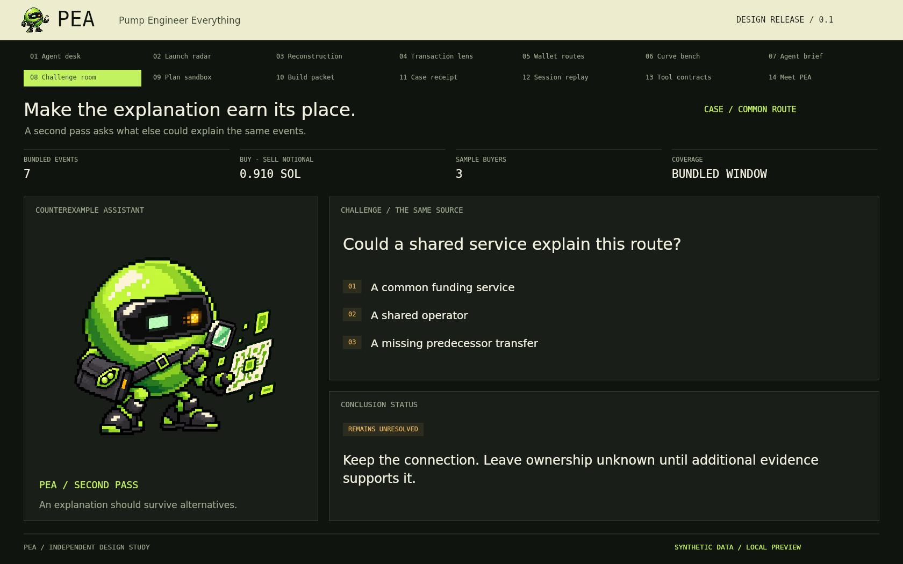

PEA takes a second pass at the explanation. Could a common service explain the same route? Is a predecessor transfer missing? Does the case support a stronger statement than the raw events do? A useful investigator can leave a question unresolved. [Counterevidence workflow](specs/AGENT-LOOP.md)

### 09 / A SOL plan sandbox

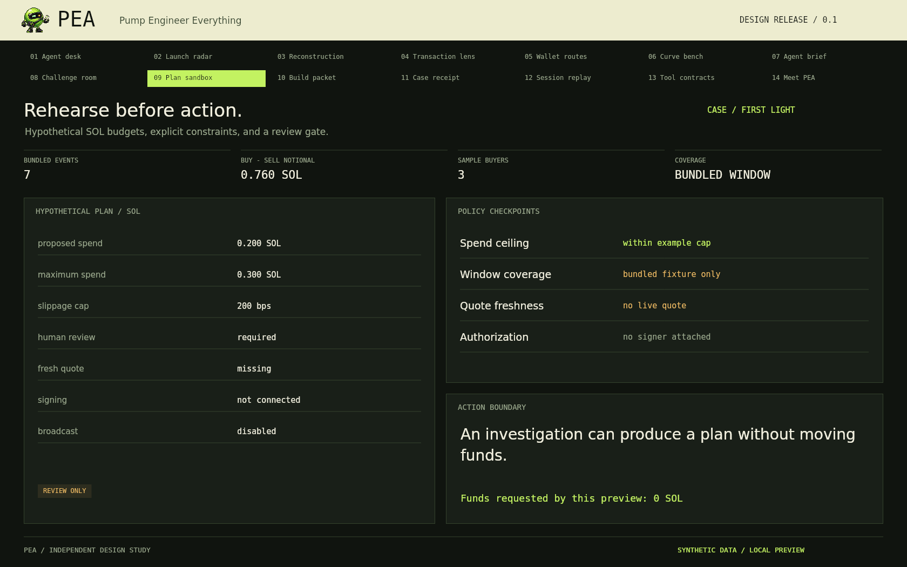

The proposed plan uses a 0.200 SOL example spend, a 0.300 SOL ceiling, and a 200 bps slippage cap. These are design assumptions, not live quotes or recommendations. Fresh quote data and authorization are absent, so the display remains review-only. The preview requests **0 SOL**. [Sandbox policy](docs/SANDBOX.md)

### 10 / Build packet

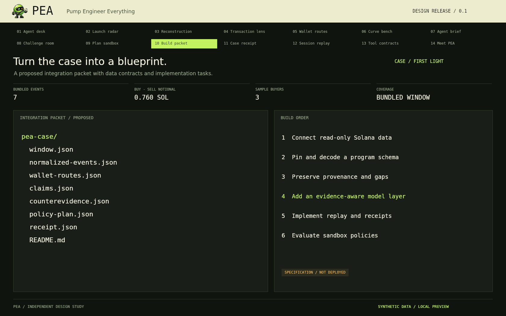

The case can become an implementation packet: source window, normalized events, routes, claims, counterevidence, policy assumptions, and receipt. The build order is explicit, starting with read-only ingestion and provenance. [Production architecture](docs/ARCHITECTURE.md)

### 11 / Case receipt

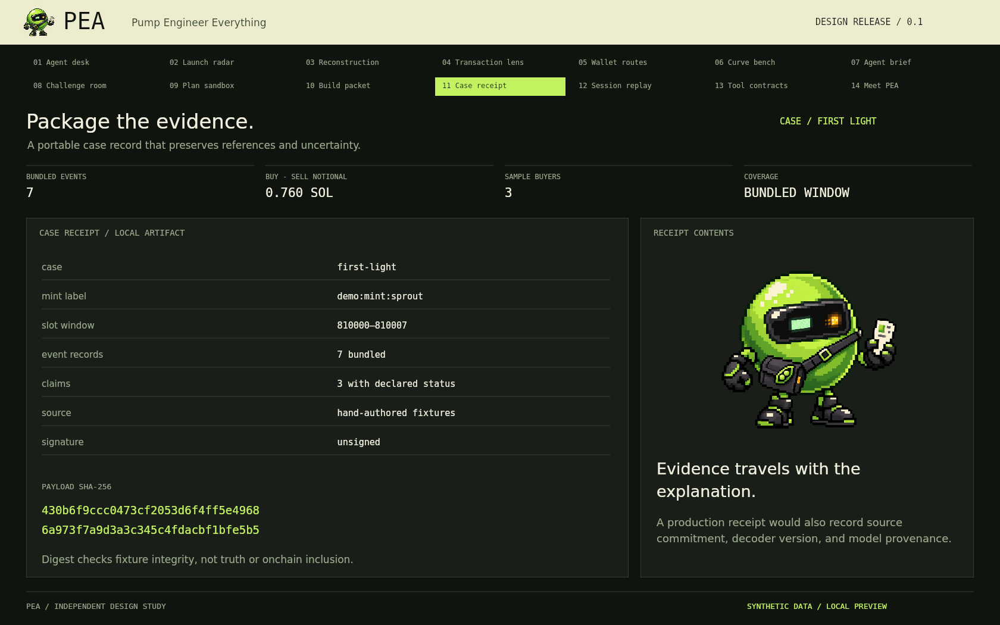

The demo receipt includes the selected case and a SHA-256 digest of its serialized fixture payload. It is unsigned. Its digest checks local payload integrity; it does not prove truth, completeness, authorship, or onchain inclusion. A future source-backed receipt would preserve adapter and model provenance too. [Receipt format](docs/RECEIPTS.md)

### 12 / Replay and missing pages

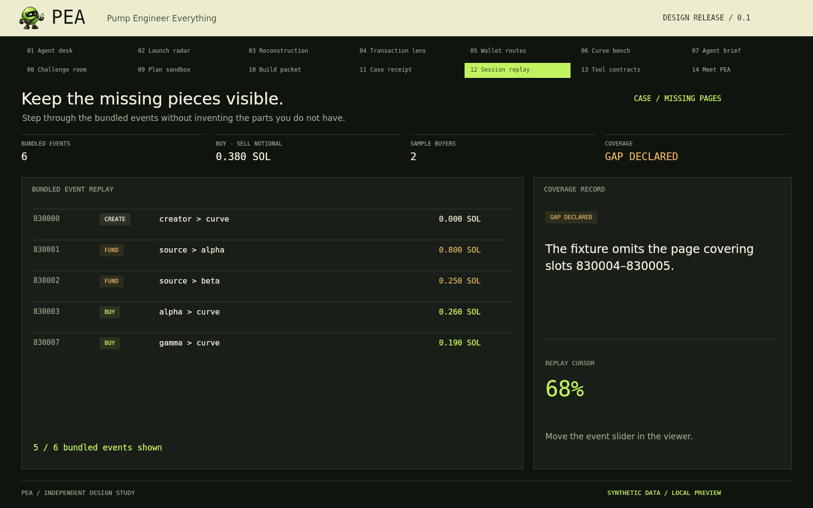

The Missing Pages case deliberately omits one interval. Replay reveals the records that exist and retains the gap. “All bundled events shown” is a statement about this example file, not complete blockchain coverage. [Replay and coverage](docs/REPLAY.md)

### 13 / A precise toolbox

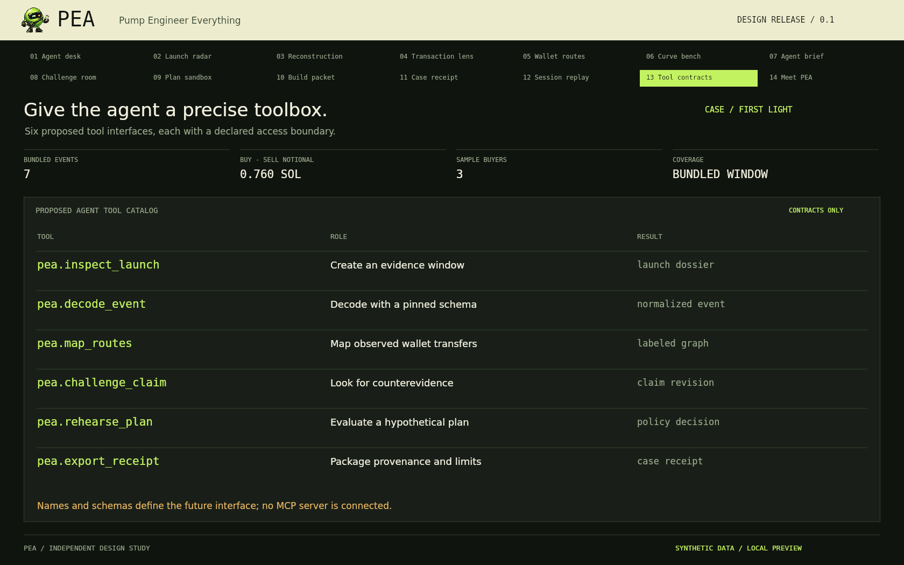

Six proposed interfaces give the agent an understandable boundary:

```text
pea.inspect_launch
pea.decode_event
pea.map_routes
pea.challenge_claim
pea.rehearse_plan
pea.export_receipt
```

They describe future agent tools; no MCP server is connected in this release. [Tool contracts](specs/TOOL-CONTRACTS.md) · [Example calls](examples/tool-calls.json)

### 14 / The workshop

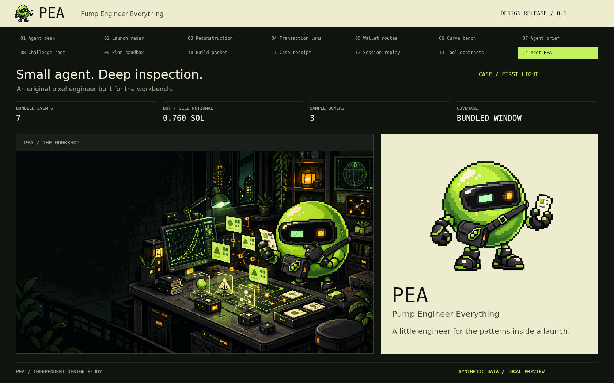


## Why REA is a useful reference

[REA](https://github.com/morluto/rea) connects AI coding agents to software-inspection tools and returns evidence about the target. PEA takes inspiration from the broad idea of inspecting a system and explaining its behavior, then applies it to launch investigations. PEA is an independent design and does not bundle REA code or claim an affiliation.

For Pump.fun, the starting point is its [public documentation and IDLs](https://github.com/pump-fun/pump-public-docs), together with public Solana data. The proposed agent reconstructs observable behavior. It does not claim to recover private server code, secret keys, hidden model weights, or anyone's intentions.

## The production design

| Layer | Proposed responsibility | Release 0.1 artifact |
|---|---|---|
| Data adapter | Fetch and retain public source records | Adapter specification |
| Decoder | Apply pinned IDLs and preserve unknown fields | Normalized record examples |
| Case store | Track windows, ordering, and gaps | Three authored fixtures |
| Relation engine | Produce evidence-labeled graph edges | Route visualization |
| Agent | Build and challenge evidence-backed explanations | Behavior spec and prompts |
| Sandbox | Evaluate a hypothetical plan against a declared policy | Review-only example panel |
| Receipt builder | Package payload and provenance | Local unsigned JSON export |
| Workbench | Make the case readable | Interactive offline preview |

An initial implementation should keep data access read-only. Any future execution system would need its own signer boundary, authorization, fresh quoting, and validation. The designed case-investigation flow is useful independently of order execution.

## Three example cases

| Case | Question | Deliberate lesson |
|---|---|---|
| First Light | What preceded the first buys? | Separate a visible funding link from an ownership claim |
| Common Route | Does one route imply one operator? | Preserve alternative explanations |
| Missing Pages | What survives incomplete coverage? | Keep gaps explicit and narrow the conclusion |

Fixture identifiers use `demo:` prefixes. They are not valid transaction signatures, token addresses, or contract addresses. All values, actors, and authored explanations are supplied locally. [Data dictionary](docs/DATA-DICTIONARY.md)

## Repository guide

| Directory | Contents |
|---|---|
| `assets/brand/` | Original PEA icon and composed project cover |
| `assets/art/` | Workshop scene and inspection pose |
| `assets/screenshots/` | Fourteen 1680 × 1050 design screenshots |
| `src/` | Shared renderer, fixture helpers, and local preview controls |
| `fixtures/` | Synthetic cases, policy display, tool catalog, and digests |
| `docs/` | Product, data, agent, integration, and visual documentation |
| `schemas/` | Proposed JSON document schemas |
| `specs/` | Tool, agent-loop, state, and release specifications |
| `prompts/` | Proposed agent behavior and evaluation instructions |
| `examples/` | Tool-call, claim, receipt, and plan examples |
| `scripts/` | Preview serving, bundling, capture, and validation |

## Development direction

The first useful backend milestone is one source-backed case: fetch a bounded window, preserve the records, decode with a pinned schema, and reproduce the timeline. Only then add model-written briefs and compare their claims against the preserved evidence. See [roadmap](docs/ROADMAP.md), [release scope](docs/RELEASE.md), and [validation record](docs/VALIDATION.md).

Created by **Ashley Tooligan**. Independent of Pump.fun, Solana, and REA. Code, design documents, and original project artwork are included under [MIT](LICENSE). External sources retain their own licenses and terms.
