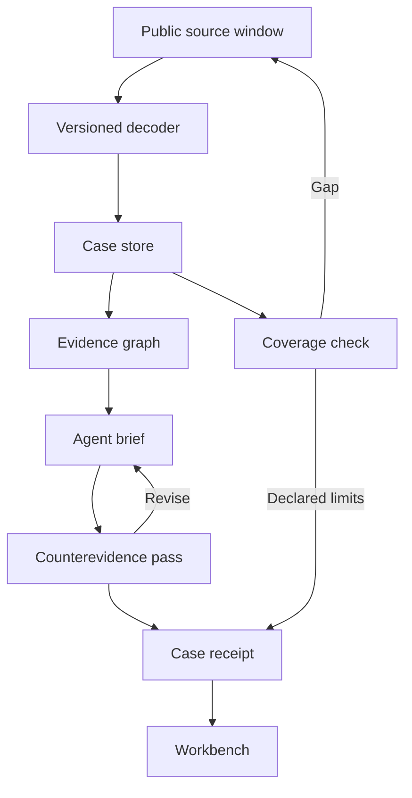

# Proposed architecture

The production design separates source data, interpretation, model-written language, and authorization. The source record must survive normalization; a claim should retain its evidence IDs; an action plan should remain a separate object from an explanation.

The adapter should record network, requested range, provider, commitment, retrieval time, and completeness. The decoder should record program ID, IDL revision, instruction position, and unsupported fields. The case store should be append-oriented and distinguish replaced interpretations from unchanged raw records.

The agent receives a bounded case with explicit capabilities. It can request more read-only evidence, propose interpretations, and revise them. The model cannot manufacture a missing event or silently transform a relationship into an identity. Tool responses remain data even if a token name contains instructions.

A sandbox can evaluate a proposed plan with explicit assumptions. A future signer, if added, belongs behind a separate authorization interface; no signer is part of the workbench design flow.

The current source consists of fixture helpers, rendering, and browser interactions. It contains no production adapter or agent runtime. `specs/` and `schemas/` define their proposed boundaries.
